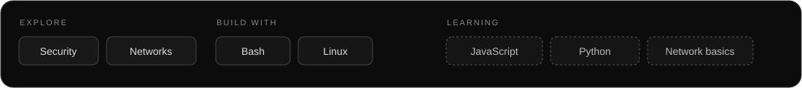

  

I'm **Yasin**, also known as **Invincible** — a security and networking enthusiast who enjoys understanding systems and building useful tools.

I’m learning in public, turning ideas into projects, and improving them through real-world feedback.

### Featured work

<table>
<tr>
<td width="50%" valign="top">

#### [Ghost Sub](https://github.com/YASIN0ASADI/ghost-sub)
Customizable subscription pages for **3X-UI, Marzban and Pasarguard**.

Branding · traffic history · TCP reachability charts · terminal installer

[Explore the project →](https://github.com/YASIN0ASADI/ghost-sub)

</td>
<td width="50%" valign="top">

#### Network tunneling · In progress
An ongoing project — still unnamed — exploring **network tunnels, transport options and reliable server-to-server connectivity**.

Building, measuring and learning — one iteration at a time.

*In development.*

</td>
</tr>
</table>

### My learning path

- **Interested in:** web security, networking and Linux systems.
- **Working with:** Bash and Linux to automate and investigate.
- **Currently learning:** networking fundamentals, JavaScript and Python.
- **Approach:** understand the problem, build something, test it, improve it.

### Connect

[Telegram ↗](https://t.me/Inv1n3ible) · [Website ↗](https://invin.ir)

---

Curiosity drives the work. Consistency makes it better.
